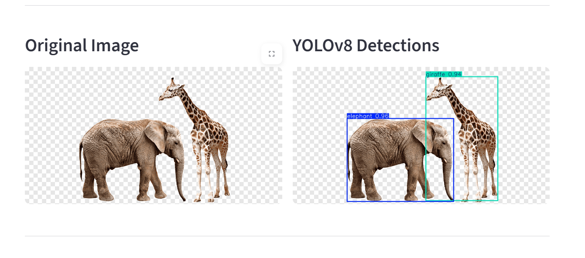
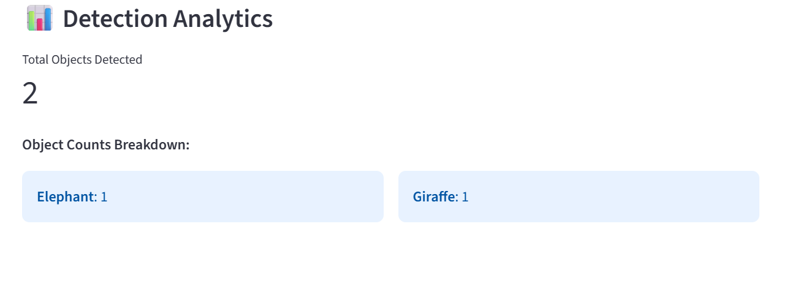

# Real-Time Object Detection and Visual Analytics
A lightweight computer vision application built with YOLOv8 and Streamlit. The tool allows users to upload images, adjust detection confidence thresholds, and inspect detected bounding boxes alongside class-level frequency counts.

## Previews
### Detection Output

### Class Breakdown and Counts

## Features

- Object detection and localization using the YOLOv8 nano model (yolov8n).
- Adjustable confidence threshold slider to filter low-probability detections.
- Side-by-side comparison of the original image and the annotated output.
- Automated object summary displaying total count and individual class distribution.

## Tech Stack

- Python 3.9+
- Ultralytics YOLOv8
- Streamlit
- Pillow / OpenCV
